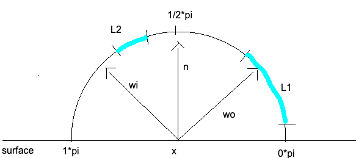
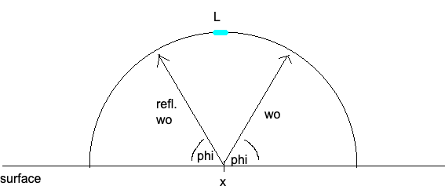
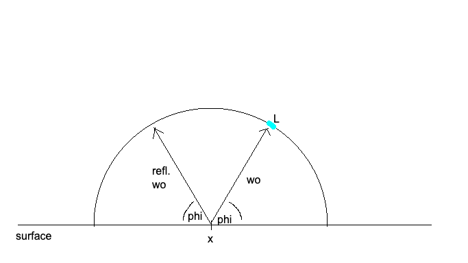
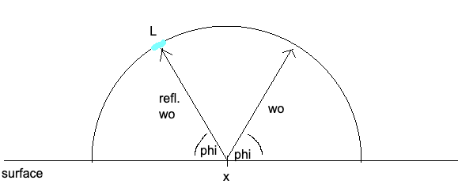

# Motivation behind Product Importance Sampling

The goal of rendering draw images as realistically as possible. 
To accomplish this, we want to simulate how real light would behave in a scene. 
By simulating real light exactly as it would behave, we could draw images that would be indistinguishable from real photographs.
Mathematically speaking, we would need to solve the following equation for every point in the scene.

$$
L_o (x \rightarrow \omega_o) = L_e (x \rightarrow \omega_o) + \int_{\Omega} f_r (x, \omega_i \rightarrow \omega_o) \, L_i (x \leftarrow \omega_i) \, \cos\theta \, d\omega_i
$$

Here, $L_o$ is the light leaving the point, $L_e$ is the light emitted from the point, $f_r$ is the bidirectional reflectance distribution function (BRDF), and $L_i$ is the light arriving at the point.
In particular, we are interested in the integral over the hemisphere $\Omega$, as $L_e$ is usually known.
Solving this integral for any given point can be very computationally expensive, so we need to find a way to approximate it efficiently.

For this approximation, Monte Carlo Integration is commonly used. 
This method allows us to estimate the integral by calculating a weighted average of many random samples. 
The higher the number of samples, the more accurate the estimate will be.

$$
L_o (x \rightarrow \omega_o) \approx L_e (x \rightarrow \omega_o) + \frac{1}{N} \sum_{n=1}^{N} \frac{f_r (x, \omega_{i,n} \rightarrow \omega_o) \, L_i (x \leftarrow \omega_{i,n}) \, \cos\theta_n}{p (\omega_{i,n})}
$$

By dividing the integrand by the probability density function $p(\omega_{i,n})$, we ensure that we do not introduce bias into our estimate.
This PDF represents the likelihood of a particular sample being chosen, and dividing by it normalizes the contribution
of each sample to the final result.
The choice of the sampling direction $\omega_{i,n}$ TODO

TODO: Explain ray intersection / path tracing algorithm / scene intersaction -> locally want to choose best ray
direction recursively, why the choice of sampling direction is so important, the choice of sampling direction, light
sampling, and brdf sampling are heuristics, path tracing as practical implementation of path tracing -> finding optimal
ray direction

Multiple Importance Sampling approximates the rendering equation's integral (See figure below) by sampling the incoming light $L_i$ and the BRDF $f_r$ independently.
It then takes a weighted sum of both these values for the final output.

Product Importance Sampling instead attempts to sample the product of these two components directly.
TODO: Product should be optimal

TODO: bidirectional BRDF -> path tracing traces reversed. Only render photons the camera actually sees. (Importon)

# Methodology

|                 |
|:--------------------------------------------------------------:|
| _Figure 1: Graphical representation of the toy example setup._ |

- TODO
    - Equal Time, Equal Samples tests
    - explain graphic

The goal of this project is to create a minimal toy example for testing a variant of Product Importance Sampling.
The benchmark compares three competing algorithms to PIS: BRDF sampling, Direct Light Sampling, and a combination of the
former two using Multiple Importance Sampling.

To keep the complexity of the project as low as possible, the scene was reduced to a minimum.
The scene only contains the object being rendered and a number of light sources.
The object is a simple surface, and we only render a single point on it.
In 3D, the vectors $\omega_i$ and $\omega_o$ would normally be encoded as Euclidean coordinates $x$, $y$, and $z$.
In 2D, we could encode them with Euclidean coordinates as well, but using polar coordinates $r$ and $\phi$ instead
further reduces the number of dimensions, as the radius $r$ is always 1.
In combination, by only considering a single point on a surface and using polar coordinates for all vectors, we
eliminate the need for absolute positions entirely.
The entire scene can now be represented by angles relative to the surface.

To better represent the state-of-the-art, a microfacet BRDF is used in all benchmarks, unless defined otherwise.
The microfacet model has more complex specular reflections than the diffuse BRDF, and some other simple BRDFs, and as
such better represents the advantages of Product Importance Sampling.

# Implementation

- Problems encountered
    - Integral calculation
    - Mapping of uniform samples (to limit sampling area)
- w_i and w_o swapped

# Benchmarks

All the following benchmarks follow the same structure.
In the _Equal Samples_ section, we compute the integral of the rendering equation with 1024 samples.
In other words: We render a single pixel with a sample count of 1024.
In the _Equal Time_ section, we limit the integral calculation not by sample count, but by a time of 0.001 seconds.

These _renders_ are performed 1024 times, with a new $\omega_o$ viewing direction each.
For each of those 1024 renders, we calculate the error with a high-sample-count reference value.
From that, we calculate the Mean Squared Error.

### Diffuse BRDF + single uniform light

The first benchmark is a sanity check for the implementation.
We render with a diffuse material and a single uniform light source.

|   Method    | MSE Equal Samples   1024 runs x 1024 samples | MSE Equal Time   1024 runs x 0.001s |
|----------------|:------------------------------------------------|:---------------------------------------|
| BRDF Sampling  |                                        0.000230 |                               0.000010 |
| Light Sampling |                                        0.000221 |                               0.000030 |
| MIS            |                                        0.000110 |                               0.000018 |
| PIS            |                                        0.000226 |                               0.000036 |

As expected, all except MIS deliver similar results in the Equal Samples benchmark.
The score of MIS is half that, because it combines two samples, one for BRDF and one for light sampling, per resulting
MIS sample.
The equal time benchmark is indirectly proportional to the calculation speed of each algorithm.

### Microfacet BRDF + 2% zenith light

|                      |
|:---------------------------------------------------:|
| _Figure 2: Positioning of the zenith light source._ |

The following benchmarks all use the microfacet model instead of a diffuse material to better represent the
state-of-the-art use cases.
The light sources from here on are all high-intensity light sources covering 2% of the hemicircle, unless specified
otherwise.
In this benchmark specifically, the light source is placed in the direction of the surface normal, i.e. at an angle
of $90^\circ$.

|   Method    | MSE Equal Samples   1024 runs x 1024 samples | MSE Equal Time   1024 runs x 0.001s |
|----------------|:------------------------------------------------|:---------------------------------------|
| BRDF Sampling  |                  0.208543 |                 0.055958 |
| Light Sampling |                  0.004186 |                 0.001341 |
| MIS            |                  0.005747 |                 0.002155 |
| PIS            |                  0.005727 |                 0.002426 |

### Microfacet BRDF + 2% front light

|                                    |
|:----------------------------------------------------------------:|
| _Figure 3: Positioning of a front light relative to $\omega_o$._ |

In this benchmark, the same light source is placed in the direction $\omega_o$, i.e. behind the camera.
The term front light is borrowed from photography, referring to a subject lit from the same direction as the camera.
This positioning represents the contribution of the surface albedo.

|   Method    | MSE Equal Samples   1024 runs x 1024 samples | MSE Equal Time   1024 runs x 0.001s |
|----------------|:------------------------------------------------|:---------------------------------------|
| BRDF Sampling  |                  0.110784 |                 0.024245 |
| Light Sampling |                  0.010034 |                 0.004485 |
| MIS            |                  0.003876 |                 0.001846 |
| PIS            |                  0.004911 |                 0.001772 |

### Microfacet BRDF + 2% back light

|                                                      |
|:---------------------------------------------------------------------------------:|
| _Figure 4: Positioning of a back light relative to the reflection of $\omega_o$._ |

Here, the same 2% hemicircle light source is placed in the direction of the reflection of $\omega_o$ about the surface
normal.
This positioning is expected to accentuate the contribution of specular reflections.

|   Method    | MSE Equal Samples   1024 runs x 1024 samples | MSE Equal Time   1024 runs x 0.001s |
|----------------|:------------------------------------------------|:---------------------------------------|
| BRDF Sampling  |                  1.164458 |                 0.290111 |
| Light Sampling |                  0.175121 |                 0.031702 |
| MIS            |                  0.060111 |                 0.029806 |
| PIS            |                  0.095535 |                 0.034527 |

### Microfacet BRDF + front, back, and zenith light

The following table shows a benchmark containing all three aforementioned light sources.

|   Method    | MSE Equal Samples   4096 runs x 1024 samples | MSE Equal Time   4096 runs x 0.001s |
|----------------|:------------------------------------------------|:---------------------------------------|
| BRDF Sampling  |                  1.431970 |                 0.375976 |
| Light Sampling |                  1.393794 |                 0.351780 |
| MIS            |                  0.424944 |                 0.221453 |
| PIS            |                  0.244756 |                 0.101233 |

# Conclusion

We can see that the Product Importance Sampling algorithm produces roughly similar results to Multiple Importance
Sampling when the complexity of the light field is low.
The benchmarks which only contained single light sources did not show significant differences in performance between
these two algorithms.
Only when multiple light sources are combined with high specularity does the product calculation show significant
benefits in performance.
For scenes containing low complexity BRDFs are fewer larger light sources, the increased computation cost per sample may
show worse results when compared to MIS or other algorithms.

As this project is very limited in scene complexity, these results do not represent real-world use cases.
Thus, further testing in an actual 3D path tracing application is needed.

# Appendix

### Microfacet BRDF + random 2% light source

|   Method    | MSE Equal Samples   4096 runs x 1024 samples | MSE Equal Time   4096 runs x 0.001s |
|----------------|:------------------------------------------------|:---------------------------------------|
| BRDF Sampling  |                  0.176544 |                 0.045782 |
| BRDF Sampling  |                  0.176544 |                 0.045782 |
| Light Sampling |                  0.010507 |                 0.005491 |
| MIS            |                  0.006193 |                 0.003142 |
| PIS            |                  0.008881 |                 0.004651 |
**MSE of**

### Microfacet BRDF + 3 random 2% light sources

|   Method    | MSE Equal Samples   4096 runs x 1024 samples | MSE Equal Time   4096 runs x 0.001s |
|----------------|:------------------------------------------------|:---------------------------------------|
| BRDF Sampling  |                  0.527210 |                 0.121707 |
| Light Sampling |                  0.271002 |                 0.069114 |
| MIS            |                  0.109378 |                 0.055997 |
| PIS            |                  0.075543 |                 0.025742 |

### Microfacet BRDF + 3 random light sources with random size and intensity

|   Method    | MSE Equal Samples   4096 runs x 1024 samples | MSE Equal Time   4096 runs x 0.001s |
|----------------|:------------------------------------------------|:---------------------------------------|
| BRDF Sampling  |                  0.647758 |                 0.178515 |
| Light Sampling |                  9.681134 |                 1.876051 |
| MIS            |                  0.720927 |                 0.296384 |
| PIS            |                  0.475834 |                 0.167014 |

### Diffuse BRDF + 3 random light sources with random size and intensity

|   Method    | MSE Equal Samples   4096 runs x 1024 samples | MSE Equal Time   4096 runs x 0.001s |
|----------------|:------------------------------------------------|:---------------------------------------|
| BRDF Sampling  |                  2.714644 |                 0.150944 |
| Light Sampling |                  1.005209 |                 0.142597 |
| MIS            |                  0.727812 |                 0.187183 |
| PIS            |                  1.545598 |                 0.232981 |
