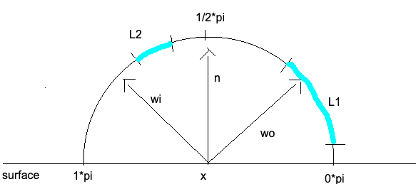
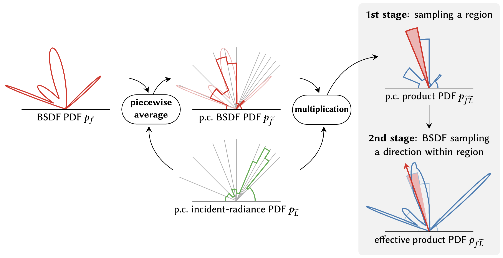
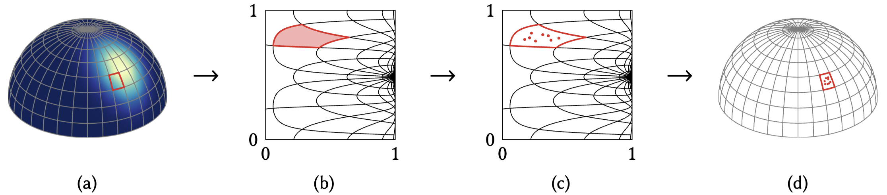
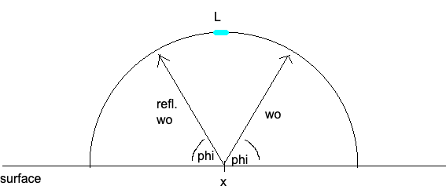
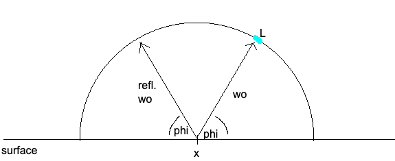
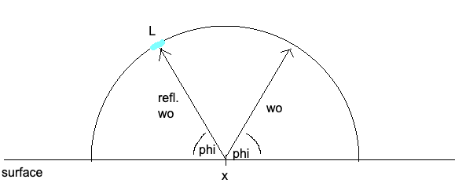

# Motivation behind Product Importance Sampling

In rendering, the goal is to draw images as realistically as possible. 
To accomplish this, we want to simulate how real light would behave in a scene. 
By simulating physical light exactly as it would behave in the real world, we could draw images that would be indistinguishable from real photographs.
Mathematically speaking, we would need to solve the following equation for every point in the scene.

$$
L_o (x \rightarrow \omega_o) = L_e (x \rightarrow \omega_o) + \int_{\Omega} f_r (x, \omega_i \rightarrow \omega_o) \, L_i (x \leftarrow \omega_i) \, \cos\theta \, d\omega_i
$$

Here, $L_o$ is the light leaving any given point in a specific direction, $L_e$ is the light emitted from that point, $f_r$ is the bidirectional reflectance distribution function (BRDF) of the material of the point, and $L_i$ is the light arriving at the point.
In combination, this formula represents how light moves and interacts with surfaces in a scene.
In particular, we are interested in the integral over the hemisphere $\Omega$, as the other component $L_e$ is usually known.
Solving this integral for any given point can be very computationally expensive, so we need to find a way to approximate it efficiently.

For this approximation, Monte Carlo Integration is commonly used. 
This method allows us to estimate the integral by calculating a weighted average of many random samples. 
The higher the number of samples, the more accurate the estimate will be.

$$
L_o (x \rightarrow \omega_o) \approx L_e (x \rightarrow \omega_o) + \frac{1}{N} \sum_{n=1}^{N} \frac{f_r (x, \omega_{i,n} \rightarrow \omega_o) \, L_i (x \leftarrow \omega_{i,n}) \, \cos\theta_n}{p (\omega_{i,n})}
$$

The new term $p(\omega_{i,n})$ represents the likelihood of a particular sample being chosen.
We can modify our distribution of sampling directions to spend more computing resources on areas that contribute more light to the final pixel value.
By dividing the resulting sample value by the PDF $p(\omega_{i,n})$, we can eliminate any bias introduced by our chosen distribution of sampling directions.
How we distribute our samples thus has a big impact on how fast the algorithm converges, which reduces noise in the resulting image.

As part of the incoming may be light that was reflected from other points, this process needs to be repeated recursively.
The viewer, or camera, looks at a surface.
For each pixel, a ray is cast from the camera and intersected with the scene to find the visible point $x$.
The brightness of that surface is determined by the light reaching it directly from light sources or by light that other surfaces reflect towards the initial surface.
To estimate the integral, a sampling direction $\omega_o$ is chosen, a new ray is cast in that direction, and the light $L_i$ arriving from it is estimated recursively in the same way at the next intersection.
This recursive accumulation of reflected light is called path tracing.

Every bounce of a path requires choosing a direction, and a poorly chosen direction wastes not just a single ray, but all the calculations of subsequent bounces.
BRDF sampling chooses directions according to $f_r$. 
Direct light sampling chooses directions according to an estimate of $L_i$.
Neither of these approaches is optimal, as BRDF sampling does not consider the light field (i.e. the light sources in the scene), and direct light sampling does not consider the BRDF.
Multiple Importance Sampling approximates the rendering equation's integral by sampling the incoming light $L_i$ and the BRDF $f_r$ independently.
It then takes a weighted sum of both these values for the final output.
This may not be optimal, MIS biases towards placing samples where just one of the factors is large.
The product $f_r (x, \omega_i \rightarrow \omega_o) \, L_i (x \leftarrow \omega_i)$ can therefore degenerate if the distributions do not overlap well, i.e. if either $f_r (x, \omega_i \rightarrow \omega_o)$ or $L_i (x \leftarrow \omega_i)$ is very small.

Product Importance Sampling instead attempts to sample the product of these two components directly, distributing samples where the product $f_r (x, \omega_i \rightarrow \omega_o) \, L_i (x \leftarrow \omega_i)$ is large.
As this product is exactly the integrand, sampling it is mathematically optimal.
In practice, $L_i$ is not known exactly, so PIS has to work with an approximation of it, and computing the product makes each sample more expensive.

The goal of this project is to determine whether the faster convergence of PIS outweighs the increased cost of computing the product at every ray intersection.

# Methodology

|                 |
|:--------------------------------------------------------------:|
| _Figure 1: Graphical representation of the toy example setup._ |

In this project, we benchmark a variant of Product Importance Sampling against other algorithms in a minimal toy example.
The benchmark compares three competing algorithms to PIS: BRDF sampling, Direct Light Sampling, and a combination of the
former two using Multiple Importance Sampling.

To keep the complexity of the project as low as possible, the scene was reduced to a minimum.
The scene only contains the object being rendered and a number of light sources.
The object is a simple surface, and we only render a single point $x$ on it.
In 3D, the vectors $\omega_i$ and $\omega_o$ would normally be encoded as Euclidean coordinates $x$, $y$, and $z$.
In 2D, we could encode them with Euclidean coordinates as well, but using polar coordinates $r$ and $\phi$ instead further reduces the number of dimensions, as the radius $r$ is always 1. (See figure 1)
In combination, by only considering a single point on a surface and using polar coordinates for all vectors, we eliminate the need for absolute positions entirely.
The entire scene can now be represented by angles relative to the surface. 
The size and placement of light sources is represented by start and end angles relative to the surface. ( $L1$ and $L2$ in figure 1)

To better represent the state-of-the-art, a microfacet BRDF is used in all benchmarks, unless defined otherwise.
The microfacet model has more complex specular reflections than the diffuse BRDF, and some other simple BRDFs, and as such better represents the advantages of Product Importance Sampling.

# Implementation

- Problems encountered
    - Integral calculation
    - Mapping of uniform samples (to limit sampling area)
    - Microfacet dimension reduction -> eval function?
- w_i and w_o swapped

Benchmark configuration can be changed using pre-processer definitions in _source/main.cpp_

Several BRDFs, Sampling algorithms, and benchmark strategies were implemented such that they can be swapped. Abstract classes

MSTree for light data structure. Calculated at runtime.

## Product Importance Sampling

|                      |
|:---------------------------------------------------:|
| _Figure 2: Calculation of the product._ |

|                      |
|:---------------------------------------------------:|
| _Figure 3: Limiting the sampling area._ |

## Light Sampling Data Structure

# Benchmarks

All the following benchmarks follow the same structure.
In the _Equal Samples_ section, we compute the integral of the rendering equation with 1024 samples.
In other words: We render a single pixel with a sample count of 1024.
In the _Equal Time_ section, we limit the integral calculation not by sample count, but by a time of 0.001 seconds.

These _renders_ are performed many times (usually 1024 or 4096), with a new $\omega_o$ viewing direction each.
For each of those renders, we calculate the squared error with a high-sample-count reference value.
From that, we calculate the Mean Squared Error.

### Diffuse BRDF + single uniform light

The first benchmark is a sanity check for the implementation.
We render with a diffuse material and a single uniform light source.

|   Method    | MSE of Equal Samples   1024 runs x 1024 samples | MSE of Equal Time   1024 runs x 0.001s |
|----------------|:------------------------------------------------|:---------------------------------------|
| BRDF Sampling  |                                        0.000230 |                               0.000010 |
| Light Sampling |                                        0.000221 |                               0.000030 |
| MIS            |                                        0.000110 |                               0.000018 |
| PIS            |                                        0.000226 |                               0.000036 |

As expected, all except MIS deliver similar results in the Equal Samples benchmark.
The score of MIS is half that, because it combines two samples, one for BRDF and one for light sampling, per resulting MIS sample.
The equal time benchmark is indirectly proportional to the calculation speed of each algorithm.

### Microfacet BRDF + 2% zenith light

|                      |
|:---------------------------------------------------:|
| _Figure 4: Positioning of the zenith light source._ |

The following benchmarks all use the microfacet model instead of a diffuse material to better represent the state-of-the-art use cases.
The light sources from here on are all high-intensity light sources covering 2% of the hemicircle, unless specified otherwise.
In this benchmark specifically, a single light source is placed in the direction of the surface normal, i.e. at an angle of $90^\circ$. (See figure 4)

|   Method    | MSE of Equal Samples   1024 runs x 1024 samples | MSE of Equal Time   1024 runs x 0.001s |
|----------------|:------------------------------------------------|:---------------------------------------|
| BRDF Sampling  |                  0.208543 |                 0.055958 |
| Light Sampling |                  0.004186 |                 0.001341 |
| MIS            |                  0.005747 |                 0.002155 |
| PIS            |                  0.005727 |                 0.002426 |

### Microfacet BRDF + 2% front light

|                                    |
|:----------------------------------------------------------------:|
| _Figure 5: Positioning of a front light relative to $\omega_o$._ |

In this benchmark, the same light source is placed in the direction $\omega_o$, i.e. behind the camera. (See figure 5)
The term front light is borrowed from photography, referring to a subject lit from the same direction as the camera.
This positioning represents the contribution of the surface albedo.

|   Method    | MSE of Equal Samples   1024 runs x 1024 samples | MSE of Equal Time   1024 runs x 0.001s |
|----------------|:------------------------------------------------|:---------------------------------------|
| BRDF Sampling  |                  0.110784 |                 0.024245 |
| Light Sampling |                  0.010034 |                 0.004485 |
| MIS            |                  0.003876 |                 0.001846 |
| PIS            |                  0.004911 |                 0.001772 |

### Microfacet BRDF + 2% back light

|                                                      |
|:---------------------------------------------------------------------------------:|
| _Figure 6: Positioning of a back light relative to the reflection of $\omega_o$._ |

Here, the same 2% hemicircle light source is placed in the direction of the reflection of $\omega_o$ about the surface normal. (See figure 6)
This positioning is expected to accentuate the contribution of specular reflections.

|   Method    | MSE of Equal Samples   1024 runs x 1024 samples | MSE of Equal Time   1024 runs x 0.001s |
|----------------|:------------------------------------------------|:---------------------------------------|
| BRDF Sampling  |                  1.164458 |                 0.290111 |
| Light Sampling |                  0.175121 |                 0.031702 |
| MIS            |                  0.060111 |                 0.029806 |
| PIS            |                  0.095535 |                 0.034527 |

### Microfacet BRDF + front, back, and zenith light

The following table shows a benchmark containing all three aforementioned light sources.

|   Method    | MSE of Equal Samples   4096 runs x 1024 samples | MSE of Equal Time   4096 runs x 0.001s |
|----------------|:------------------------------------------------|:---------------------------------------|
| BRDF Sampling  |                  1.431970 |                 0.375976 |
| Light Sampling |                  1.393794 |                 0.351780 |
| MIS            |                  0.424944 |                 0.221453 |
| PIS            |                  0.244756 |                 0.101233 |

# Conclusion

We can see that the Product Importance Sampling algorithm produces roughly similar results to Multiple Importance Sampling when the complexity of the light field is low, e.g. when only a single light source is present.
Only when multiple light sources are combined with high specularity does the product calculation show significant benefits in performance.
For scenes containing low complexity BRDFs, e.g. a simple diffuse model, or fewer larger light sources, the increased computational cost per sample may show slower convergence when compared to MIS or other algorithms. (See appendix for more benchmark results)

As this project is very limited in scene complexity, these results do not represent real-world use cases.
Thus, further testing in an actual 3D path tracing application is needed.

# Appendix

### Microfacet BRDF + random 2% light source

|   Method    | MSE of Equal Samples   4096 runs x 1024 samples | MSE of Equal Time   4096 runs x 0.001s |
|----------------|:------------------------------------------------|:---------------------------------------|
| BRDF Sampling  |                  0.176544 |                 0.045782 |
| BRDF Sampling  |                  0.176544 |                 0.045782 |
| Light Sampling |                  0.010507 |                 0.005491 |
| MIS            |                  0.006193 |                 0.003142 |
| PIS            |                  0.008881 |                 0.004651 |
**MSE of**

### Microfacet BRDF + 3 random 2% light sources

|   Method    | MSE of Equal Samples   4096 runs x 1024 samples | MSE of Equal Time   4096 runs x 0.001s |
|----------------|:------------------------------------------------|:---------------------------------------|
| BRDF Sampling  |                  0.527210 |                 0.121707 |
| Light Sampling |                  0.271002 |                 0.069114 |
| MIS            |                  0.109378 |                 0.055997 |
| PIS            |                  0.075543 |                 0.025742 |

### Microfacet BRDF + 3 random light sources with random size and intensity

|   Method    | MSE of Equal Samples   4096 runs x 1024 samples | MSE of Equal Time   4096 runs x 0.001s |
|----------------|:------------------------------------------------|:---------------------------------------|
| BRDF Sampling  |                  0.647758 |                 0.178515 |
| Light Sampling |                  9.681134 |                 1.876051 |
| MIS            |                  0.720927 |                 0.296384 |
| PIS            |                  0.475834 |                 0.167014 |

### Diffuse BRDF + 3 random light sources with random size and intensity

|   Method    | MSE of Equal Samples   4096 runs x 1024 samples | MSE of Equal Time   4096 runs x 0.001s |
|----------------|:------------------------------------------------|:---------------------------------------|
| BRDF Sampling  |                  2.714644 |                 0.150944 |
| Light Sampling |                  1.005209 |                 0.142597 |
| MIS            |                  0.727812 |                 0.187183 |
| PIS            |                  1.545598 |                 0.232981 |
